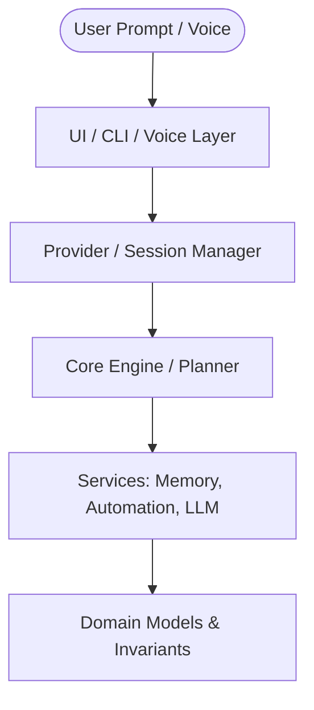
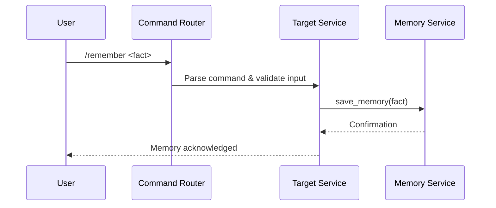

# ATLAS Workflow: Visual System Planning

> **Goal:** Render architectural intent, data flow, and structural topologies using clear Mermaid diagrams to eliminate ambiguity between Council entities and the user.

---

## Supported Visual Formats

### 1. Subsystem Architecture (Graph / Flowchart)

### 2. Sequence of Interaction

### 3. Guidelines
- Diagram all cross-boundary interactions before refactoring.
- Include failure paths and fallback loops.
- Keep diagrams concise: focus on the subsystems directly affected.

